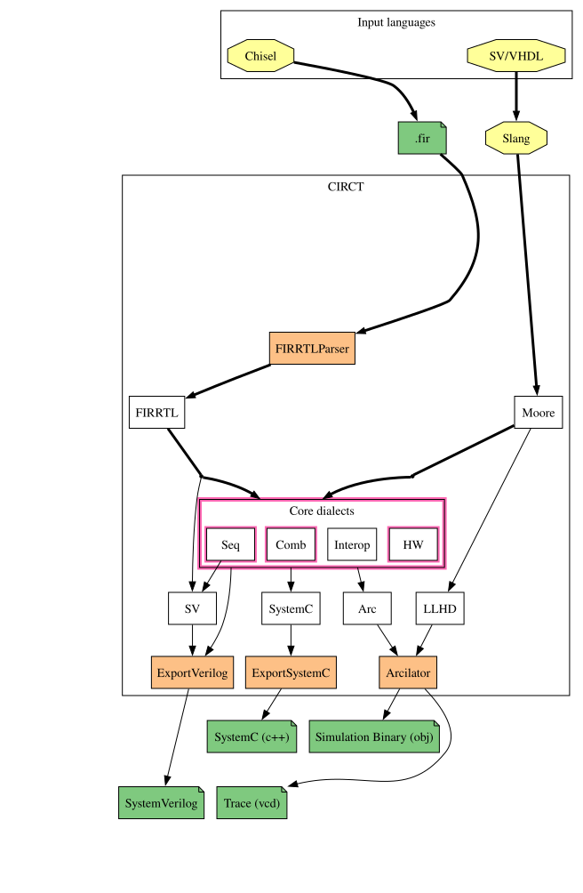

# RTL timing for Atlas

The `rtl-op-timing-v1` provider uses timing computed from selected Atlas RTL for scheduling, delay insertion and final verification. A CIRCT HW IR exporter and control simulator produce `merlin.op_timing.v1` facts; the compiler supplies instruction structure and resolves timing on concrete operands. Optional `merlin.op_pairs.v1` facts admit overlap backed by assertion-checked sweeps.



See the [extractor reference](../../tools/rtl_extract/README.md) for simulation and schemas, and the [verification map](verification.md) for tests and execution evidence.

## The provider

Selection pins facts by SHA-256 and retains `atlas.rtl_evidence`. Pair facts must match the hardware IR digest, pin the selected operation facts, name resolved blocks and report checked assertions. Subsequent loads recheck selection; resolved exports include both digests. [AtlasRTLEvidence.cpp](../../lib/AtlasRTLEvidence.cpp) implements these checks; [test_rtl_timing.py](../../test/test_rtl_timing.py) exercises malformed and mismatched evidence.

Timing passes resolve `provider=<id>`, then retained `atlas.timing_provider`, then `rtl-op-timing-v1` over selected evidence, otherwise `npu-model-rtl-match-v1`. The model is refused over selected evidence. Without selection, the default provider emits exactly what it did before RTL selection existed; the one exception is a block falling through into ECALL, whose drain now ends on a NOP (DELAY then NOP), accepting a previously rejected program. [AtlasStream.cpp](../../lib/AtlasStream.cpp) implements the guard; [test_delay_insertion.py](../../test/test_delay_insertion.py) checks halt padding.

The common verifier checks dependencies, reservations and drained boundaries. Emission and LLVM handoff check selected streams even without timing metadata. `atlas-emit --allow-untimed` permits inspection without a timing claim; `atlas-emit --rtl-timing-json` requires a safe timed selection and exports footprints, block-relative issues, successors and wait-relative epochs. [test_rtl_export.py](../../test/test_rtl_export.py) checks these boundaries.

## Guarantees and assumptions

[AtlasRTLSelection.cpp](../../lib/AtlasRTLSelection.cpp) enforces these rules; [verification](verification.md) maps each to evidence.

- Every reachable block starts with idle engines and no pending DMA, and drains before its successor or ECALL. Branch delay slots contain ADDI or LUI; stalls before redirects or halt end on a NOP. Programs are bounded by 32,768 words and 1,000,000 issue cycles.
- Footprints use exact scalar values at each concrete block entry, following one branch edge when operands are known, otherwise both. Scheduling and verification respect every distinct footprint group. After 4096 block entries, values merge across paths; moving or unknown addresses may be rejected. Operand alignment, range and bank checks apply in every context.
- VLOAD and VSTORE reserve separate paths and overlap subject to VMEM bank and MREG port/release rules. VPU and XLU exclude each other; VLS and either MXU can overlap them under memory rules. Each MXU reserves its own unit. VSTORE protects its source until it drains against writers other than VLOAD. Matmul retains its weight slot through its last accumulator write.
- Without pair facts, VPU commands wait for `next_issue_age`, and commands on one MXU wait for its busy end. With them, every overlapping pair must match its ordered operations, covered gap and operand relation: disjoint or shared physical MREG banks and, where applicable, same or other accumulator and weight slot. Other resource rules still apply. Selected facts cap each VPU/MXU at two live commands; missing coverage falls back to exclusive admission.
- VPU live windows end at `next_issue_age`; MXU windows include their last event and MREG read responses. Hold ends are inclusive: occupation through age 34 permits exclusive issue at 35.

These guarantees assume selected hardware, deasserted reset, quiescent entry, immutable instructions, supplied operand data and no concurrent host access to VMEM or DMA base changes. Competing requesters and alternative memories need review. Selected VMEM/MREG response latency, measured from IR, is one cycle. Extraction assumes data-independent engine control, rejects unknown control outputs and permits only explicitly declared unreset registers. This is timing evidence, not numerical qualification.

### DMA

DMA requires `dma=wait`. Launch captures scalar operands and the global DRAM base; both may then be reused. VMEM/DRAM effects remain live until a matching channel wait. Completion latency is unknown; issue coordinates across waits are lower bounds.

One transfer may be pending per channel. The eight slots use launch count: launch `n` requires launch `n-8` to have been waited. Every transfer needs a wait within its block; markers and halt require completion. Pending VMEM windows must be disjoint from transfers and VLS tiles; scalar reads may share a store window. DRAM spans may overlap only for two reads. Empty, stale and wrong-channel waits fail. These compiler protections cover unguarded RTL channel reuse and address overlap; [test_rtl_engines.py](../../test/test_rtl_engines.py) checks them.

### Gap coverage

Gap coverage uses `stable_gap`, except for a pair with a DMA launch: a rejected gap whose only failure is a moved DMA or DRAM event does not bind. The bound is one past the last other failing gap, or 1 if none; a firing assertion always binds. Two launches bind their order. A VLS compiler bound can therefore be below `stable_gap`. [test_rtl_gap_coverage.py](../../test/test_rtl_gap_coverage.py) compares compiler gaps with this bound, rejects unmapped records and requires unsupported operations to be provider rejections.

## Scheduler

`--schedule-atlas-stream="rtl-best-of=true rtl-dma-estimate=true"` enables ordering estimates under `rtl-op-timing-v1`; both default true and other providers ignore them. The options compare source/list orders and use model DMA estimates in list priorities. They change only the orders tried; the common verifier checks every result and entry context. Estimates do not assign DMA completion latency. [test_rtl_scheduler.py](../../test/test_rtl_scheduler.py) covers these policies.

## Reproduce

Run from this repository root with the prepared environment and a new output directory. Selected inputs are read-only. Keep sweeps beside facts for gap-test discovery. Loops invoke one command per artifact; extraction, sweeps and model builds can exceed a minute.

```sh
source build/env.sh
export PYTHONPATH="$PWD/tools:$PYTHONPATH"
unset ATLAS_TIMING_PROBE
X=$PWD/build/manual-rtl-extract
R=${ATLAS_HW_IR%/build/rtl-extract/ir-debug/*}
P=${R%/generators/*}/.conda-env/riscv-tools
INPUT=$R/build/rtl-timing/ee290-portable-helper-check/inputs
H=$X/ir-debug/ee290.debug.hw.mlir
E=$X/exporter/hw_ir_export
```

Retained debug HW IR and manifest, then exporter:

```sh
"$VPY" tools/retain-ee290-hw-ir.py --mode debug \
  --firrtl "$INPUT/input.fir" --annotations "$INPUT/original.anno.json" \
  --lowering-options "$INPUT/lowering-options.txt" \
  --firtool "$P/bin/firtool" --circt-opt "$P/bin/circt-opt" --output "$X/ir-debug"
cmake -S tools/rtl_extract/export -B "$X/exporter" \
  -DCMAKE_BUILD_TYPE=Release -DCIRCT_DIR="$P/lib/cmake/circt" \
  -DMLIR_DIR="$P/lib/cmake/mlir" -DLLVM_DIR="$P/lib/cmake/llvm"
cmake --build "$X/exporter" -j32
```

Debug lowering preserves named values and inline memories. Hierarchy-output paths depend on `X`, so IR digests can differ with output location; downstream artifacts must use the same IR.

Operation facts and compiler selection copy:

```sh
"$VPY" -m rtl_extract --hw-ir "$H" --exporter "$E" --target atlas --output "$X/out/all.json"
cp "$X/out/all.json" "$X/out/compiler-facts.json"
```

Pair and sequence sweeps:

```sh
for name in vlsu vpu mxu0 mxu1 core core_vpu core_dma core_dma_mxu core_mxu core_mxu_cross core_mxu_units core_mxu_same core_mxu_shared; do
  "$VPY" -m rtl_extract.pairs --hw-ir "$H" --exporter "$E" --target atlas \
    --pairs "$name" --jobs 32 --output "$X/out/pairs-$name.json"
done
for name in mxu0 mxu1 core_vpu core_mxu; do
  "$VPY" -m rtl_extract.sequences --hw-ir "$H" --exporter "$E" --target atlas \
    --sequences "$name" --jobs 32 --output "$X/out/sequences-$name.json"
done
```

Generated specs load through [spec.py](../../tools/rtl_extract/spec.py). Export them for inspection; expectations are pinned regressions, not extraction inputs.

```sh
for name in pairs/core pairs/core_dma pairs/core_dma_mxu pairs/core_mxu pairs/core_mxu_cross pairs/core_mxu_units pairs/core_mxu_same pairs/core_mxu_shared pairs/core_vpu sequences/core_vpu sequences/core_mxu system/core system/core_dma; do
  "$VPY" tools/rtl_extract/targets/atlas/gen_core.py "$name.yaml" --output "$X/specs/$name.yaml"
done
```

VPU, MXU and combined pair facts:

```sh
"$VPY" -m rtl_extract.pairfacts --target atlas --op-timing "$X/out/compiler-facts.json" \
  --pairs "$X/out/pairs-core_vpu.json" --sequences "$X/out/sequences-core_vpu.json" \
  --output "$X/out/op-pairs-vpu.json"
"$VPY" -m rtl_extract.pairfacts --target atlas --op-timing "$X/out/compiler-facts.json" \
  --pairs "$X/out/pairs-core_mxu_same.json" "$X/out/pairs-core_mxu_shared.json" \
  --output "$X/out/op-pairs-mxu.json"
"$VPY" -m rtl_extract.pairfacts --target atlas --op-timing "$X/out/compiler-facts.json" \
  --pairs "$X/out/pairs-core_vpu.json" "$X/out/pairs-core_mxu_same.json" "$X/out/pairs-core_mxu_shared.json" \
  --sequences "$X/out/sequences-core_vpu.json" --output "$X/out/op-pairs.json"
```

MXU chains validate uniform spacing; including them in selection raises observed capacity beyond the reviewed two-command rule.

CMake timing probe and replay with the prepared model:

```sh
cmake --build build/compiler --target rtl-timing-facts-probe -j32
"$VPY" tools/replay-ee290-compute.py --facts "$X/out/compiler-facts.json" \
  --bin "$ATLAS_OOT_BIN_DIR" --model "$ATLAS_EE290_COMPUTE_MODEL" --work "$X/replay" --jobs 32
"$VPY" tools/replay-ee290-compute.py --facts "$X/out/compiler-facts.json" \
  --pairs "$X/out/op-pairs.json" --bin "$ATLAS_OOT_BIN_DIR" \
  --model "$ATLAS_EE290_COMPUTE_MODEL" --work "$X/replay-pairs" --jobs 32
```

To reproduce the model from selected SV:

```sh
"$VPY" tools/replay-ee290-compute.py --facts "$X/out/compiler-facts.json" \
  --bin "$ATLAS_OOT_BIN_DIR" --rtl "$R/build/rtl-timing/atlascore-replay-002/inputs" \
  --verilator "${R%/generators/*}/.conda-env/bin/verilator_bin" \
  --verilator-root "${R%/generators/*}/.conda-env/share/verilator" --work "$X/replay-built" --jobs 32
```

The model is written to that work directory's `obj/VAtlasCore`.

Compiler selection and resolved export (substitute an untimed physical program):

```sh
"$ATLAS_OOT_BIN_DIR/atlas-opt" prog.mlir \
  --select-atlas-rtl-evidence="op-timing=$X/out/compiler-facts.json op-timing-sha256=$(sha256sum "$X/out/compiler-facts.json" | cut -d' ' -f1) dma=wait" \
  --schedule-atlas-stream --verify-atlas-timing -o "$X/final.mlir"
"$ATLAS_EMIT" --rtl-timing-json "$X/final.mlir" > "$X/resolved.json"
```

Add `op-pairs=$X/out/op-pairs.json op-pairs-sha256=<digest>` for pair selection; use `--insert-atlas-delays` for source-order timing. Virtual programs first run `--verify-atlas-virtual-stream --schedule-atlas-virtual --lower-atlas-virtual-to-machine`; selection survives lowering. Virtual scheduling uses provider latencies and same-unit intervals on canonical operands.

## Not covered

- Runtime-dependent addresses, moving addresses beyond 4096 block-entry contexts, or engine/DMA work crossing blocks.
- Unbounded same-unit overlap: selection caps each unit at two live commands, although some uniformly spaced MXU chains accept three.
- Exact weight-read timing: matmul conservatively owns its weight slot through its last accumulator write.
- DMA completion latency, concurrent host traffic, or memories outside selected assumptions.
- Pair-sweep records omit operand overlays, `as` names and relations; `rtl_extract.pairfacts` takes them from current YAML by block name, and binding them in records requires a re-sweep.
- Replay does not bind the VPU own-unit hold end; the pair-sweep guard check and 256 comparisons in the [compiler cross-check](verification.md#extraction-and-compiler-cross-check) cover it.
- Virtual scheduling models same-unit intervals, not physical cross-engine exclusion; the physical verifier checks the lowered stream.
- A VLOAD write into an MREG bank still being read is not asserted by RTL; compiler release rules protect it.
